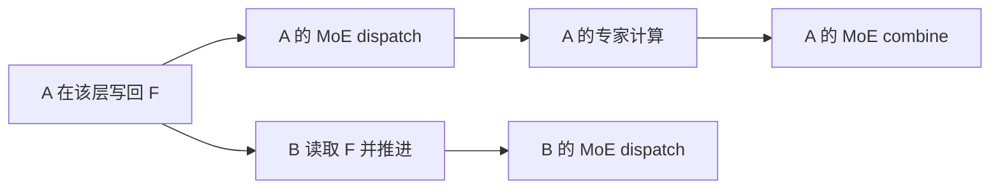

# vLLM GDN 与 Mamba2 的 token 粒度 DBO

在 Model Runner V2 内，将一次调度的 packed batch 切成两个连续 ubatch，允许长 prefill 在请求内部切开。两个 ubatch 在已有的 MoE 通信交接点交错执行，使一个 ubatch 的专家通信有机会被另一个的计算覆盖。跨切点请求的两个片段逐层读写**同一个整步工作状态块**。

`GDN_Mamba_DBO_agrs` 在 `GDN_Mamba_DBO_Base` 的 GDN/Mamba2 实现上接入 CUDA AG/RS DBO，保留 `none`、`align`、eager 和兼容的单 token decode FULL CUDA Graph。实现基于子模块提交 `9ad52f28fe`，其源码树与 vLLM `v0.34.0` 一致，开发目录沿用 `vllm-v0.33/`。安装与基线工作区见[环境与初始化](later.md)。

## 运行条件

| 项目 | 当前实现 |
| --- | --- |
| 模型与后端 | 纯文本 MoE，使用标准 `MambaHybridModelState`，Mamba cache group 使用 `GDNAttentionMetadataBuilder` 或 `Mamba2AttentionMetadataBuilder`。配置校验通过后，`maybe_build_ubatch_runner()` 还会核对实际加载的 ModelState 和 builder 类型。 |
| 并行与调度 | CUDA，至少两个 DP rank，开启 EP，TP/PP/PCP/DCP 均为 1，一步切两个 ubatch。使用 `--enable-dbo --no-async-scheduling`，关闭 LoRA、投机解码、ReplaySSM 和 KV transfer。 |
| 状态缓存 | `none` 使用 `--no-enable-prefix-caching`。`align` 使用 `--enable-prefix-caching --mamba-cache-mode align`。这类模型开启 prefix caching 时，默认的 `none` 会归一化为 `align`。 |
| 执行模式 | prefill 和混合负载走 eager。均匀单 token decode 可匹配兼容的 FULL 图。是否切分由全部 rank 的投票及 token 阈值决定。 |

本分支的子模块提交已包含 CUDA AG/RS DBO 和相应的 workspace、padding 修复。CUDA AG/RS DBO 使用单机 DP+EP、TP=1、modular MoE kernel 和标准 NCCL。以下以双卡 BF16 Granite 的 eager 联调为例。

```bash
VLLM_USE_NCCL_SYMM_MEM=0 vllm serve ibm-granite/granite-4.0-h-tiny \
  --dtype bfloat16 --data-parallel-size 2 --tensor-parallel-size 1 \
  --enable-expert-parallel --all2all-backend allgather_reducescatter \
  --moe-backend triton --enable-dbo --no-async-scheduling \
  --no-enable-prefix-caching --enforce-eager --max-model-len 4096
```

测量 `align` 时改用 `--enable-prefix-caching --mamba-cache-mode align`。已有双卡曲线来自独立候选版的 DeepSeek-V2-Lite-Chat。正式 Hybrid DBO PR 在 `GDN_Mamba_DBO_Base` 上使用目标上游支持的 EP 后端。[AG/RS 补丁与实验记录](experiments/agrs_dbo_pr/README.md) · [上游 PR #68535](https://github.com/vllm-project/vllm/pull/68535)

## 整步工作状态与片段 metadata

设请求在整步开始前已处理 `C` 个 token，本步调度 `N` 个 token。片段覆盖本步的 `[a, b)`，query 长度为 `b-a`，片段起点的有效上下文为 `C+a`，`seq_lens` 为 `C+b`。普通 attention 的位置和 slot mapping 取 token 切片，block table 取请求行切片。原请求进度、输出顺序和采样由整步管理。

设每层每请求的 `F` 为整步执行时更新的工作块。GDN 和 Mamba2 使用同一个块 ID 寻址该层的 conv 与 SSM 缓存，各层的实际存储独立。整步预处理准备 `F` 后，A 推进到切点并写回 `F`，B 读到该状态后继续写回同一块。首次 prefill 的 A 使用零初态，B 使用 A 的末态。`F` 由现有 cache manager 分配和回收。此链路复用[整步 pre-copy][hybrid-precopy]、[GDN forward][gdn-forward]与[Mamba2 mixer][mamba2-mixer]。

例如完整 batch 的 query 长度为 `[1, 1, 64]`，在 token 33 处切分。原第 2 行的 prefill 从位置 0 开始，Mamba block size 为 32，假设该步没有预留内部 checkpoint，请求在 `align` 下的逻辑表为 `[null, 180]`。

| 视图 | prefill 请求行 | query 长度 | `seq_lens` | 初态已处理 token | 工作块 ID |
| --- | ---: | ---: | ---: | ---: | ---: |
| 整步 | 2 | 64 | 64 | 0 | 180 |
| A | 2 | 31 | 31 | 0 | 180 |
| B | 0 | 33 | 64 | 31 | 180 |

A 若按自己的 `seq_lens=31` 选列，会取到 `null`。B 若从整步表的第 0 行重新算，会取到另一请求的状态。当前实现按整步终点选列，再按原请求行切分，因此 A、B 都拿到 180，片段的有效 `seq_lens` 各自保留。

### 工作索引的准备与消费

1. `GPUModelRunner.execute_model()` 先准备整步 block tables 和 slot mappings，对真实 batch 调用一次 `preprocess_state()`。`align` 下的 pre-copy 用 worker 请求槽 `idx_mapping` 索引 `BlockTables.block_tables[gid].gpu`。整步工作索引用按本批 packed 顺序 gather 的 `input_block_tables[gid]`。GPU context 在初始化时把两套基址分别登记到 `block_table_ptrs` 和 `aligned_index_block_table_ptrs`。[逻辑表与整步输入表][block-table] · [aligned-index 计算][aligned-indices]
2. `UBatchRunner.prepare()` 先调用 `create_ubatch_slices()`，随后把完整的 `InputBatch` 和切片交给 `ModelState.prepare_ubatch_attn_inputs()`。`align` 下，`MambaHybridModelState._gather_aligned_state_indices()` 只对整步 `seq_lens` 调用一次 `_mamba_ctx.compute_aligned_state_indices()`，按 `max((seq_len-1)//block_size, 0)` 选列，行数取 `num_reqs_after_padding`。结果按实际 cache group ID 组织，每片用 `request_slice` 取相应行，存入 `MambaUBatchAttnInputs.working_state_indices`。`none` 直接用各片的紧凑 block table。
3. `MambaHybridModelState.prepare_attn(..., ubatch_idx=i)` 将片段输入传入 `build_attn_metadata()`。`MambaHybridAttnMetadata.get_extra_common_attn_kwargs()` 为对应 group 填入 `CommonAttentionMetadata.mamba_working_state_indices`，原 `block_table_tensor` 仍是片段子表。各片用 `get_metadata_builder(i)` 获取自己的 builder。带显式工作索引的 Mamba group 单独构建 metadata，以免 `update_block_table()` 按片段长度重新选块。
4. 整步 `align` 路径在需要 GDN 捷径时也使用 `_gather_aligned_state_indices()`，将结果交给 builder 0 的 `mamba_aligned_state_indices`。整步 Mamba2 继续调用 `mamba_get_block_table_tensor()`。

| 后端 | 片段 metadata 的消费 |
| --- | --- |
| GDN | `GDNAttentionMetadataBuilder.build()` 优先使用显式工作索引，派生 `non_spec_state_indices_tensor` 和 `prefill_state_indices`，让 causal-conv 与 recurrent state 同时接续。 |
| Mamba2 | `BaseMambaAttentionMetadataBuilder.build()` 优先使用显式工作索引，派生 `state_indices_tensor_p/d`。初态 mask 与 SSD chunk metadata 仍依据片段的 query 长度、`seq_lens` 和 `is_prefilling` 构建。 |

## 执行次序、padding 与 CUDA Graph

同一请求、同一层上，A 的 conv/SSM 写回先于 B 的读取。普通 attention 的 B 同样依赖 A 的 KV 写入。两个 ubatch 共享 compute stream，沿用已有 MoE yield 和通信流事件。metadata 可提前准备，状态内容在片段实际 forward 时读取。合并后只对整步输出做一次采样。[UBatchContext 与 stream 交接][ubatch-context]



`dispatch_cg_and_sync_dp()` 使用全 rank 投票、最小 rank 的 token 阈值和按最大 token 数 padding。默认阈值是纯 decode 32 token、含 prefill 的步 512 token。各 rank 对齐 token 切片尺寸和 collective 顺序。[DP 协议][dp]

- **Eager 的全 padding 片段。** `create_ubatch_slices()` 返回空请求切片。普通 attention 跳过 metadata 构建。对 Hybrid，Runner 复用一行、一 token 的 dummy decode，所有表项使用 `NULL_BLOCK_ID`，slot mapping 全为 `PAD_SLOT_ID`。两种路径都用原 token 切片和 padding mask 参加 EP collective。
- **FULL 的全 padding 片段。** 均匀 decode 按捕获时的 padded 请求数固定切片。假设命中 64 token 的图且本 rank 有 32 个真实请求，A 的请求切片是 `[0:32]`，B 是 `[32:64]`。B 使用预留的 padding 行和 null 状态块。原有 `2 * min_tokens < graph_num_tokens` 时回到 eager 的条件仍生效，等号情形可以匹配 FULL。
- **捕获与 replay。** `ModelCudaGraphManager.capture()` 用 dummy 输入经 `UBatchRunner.prepare()` 构建两片 metadata 和捕获上下文。Replay 前再次执行 `prepare()`，原地更新片段的 query offsets、sequence lengths 和 builder 的图缓冲，然后重放已捕获的图。运行时因整 rank 无真实请求而走的 dummy step 会投票整步执行。这条规则与图捕获使用的 dummy 输入独立。[图捕获入口][capture]

## Prefix cache 与内部 checkpoint

`align` 保留整步 pre-copy 和 prefix cache 语义。若本步给任何已调度请求预留了内部 checkpoint，`MambaManager.has_prefill_checkpoint()` 经 `KVCacheManager` 和 `SchedulerOutput.has_mamba_prefill_checkpoint` 通知 runner。该 rank 在现有 DP 协议中投票关闭 ubatch，所有 rank 在 forward 前选中原整步路径，按原计划导出状态与发布 prefix cache。

允许切分的步通过 `CommonAttentionMetadata.skip_mamba_prefill_checkpoints` 禁止 `MambaPrefillCheckpointBuilder` 根据片段长度临时规划导出。工作状态的中间值仍只写入 `F`。

后续接入片段内部导出时，可按原请求行和绝对位置投影已有计划。`C+a < P <= C+b` 的 checkpoint 由片段 `[a,b)` 写入原定目的块，局部 offset 为 `P-(C+a)`。若 `P` 在 A 的终点，可在 B 覆写前复制 `F`。片段内部需同时导出 conv 和 SSM，特别要处理距片段起点不足一个卷积历史窗口的情形。[checkpoint 计划][checkpoint-builder] · [卷积导出条件][checkpoint-exporter]

Mamba2 可再按局部 offset 生成 SSD chunk 边界。对 FlashInfer GDN，可验证用 `prefix_lens` 使导出对齐到绝对 token 网格。以片段起点 125、终点 250、间隔 64 为例，位置 128、192 会成为候选快照，可将原计划要求的位置 192 写入其目的块。无法导出完整快照的步继续整步执行。[FlashInfer GDN prefill](https://github.com/flashinfer-ai/flashinfer/blob/v0.7.3/flashinfer/gdn_prefill.py#L1429-L1448)

## 验证与模型选择

合入 CUDA AG/RS 后在本地 RTX 3060 Laptop GPU 上运行下列回归，**399 项通过**。双卡 NCCL 用例因 GPU 数量不足跳过。状态接续回归用真实 GDN 和 Mamba2 kernel，覆盖 `none`、`align`、混合 prefill/decode、eager 全 padding 和 FULL replay。该回归用 `dbo_yield()` 模拟 MoE 交接。CUDA 下两种缓存模式的 AG/RS DBO 配置检查均通过。

在子模块目录下运行以下回归。

```bash
VLLM_GPU_SYNC_CHECK=error uv run --offline --no-project --python .venv/bin/python \
  .venv/bin/python -m pytest -q \
  tests/kernels/moe/test_naive_dp_ep_dbo.py \
  tests/v1/worker/test_gpu_ubatch_slicing.py \
  tests/v1/worker/test_workspace.py \
  tests/v1/worker/test_gpu_model_runner_v2.py \
  tests/v1/attention/test_gdn_metadata_builder.py \
  tests/v1/attention/test_mamba_metadata_builder.py \
  tests/v1/core/prefix_cache/test_partial_prefix_cache_hits.py \
  tests/v1/distributed/test_dbo.py::test_dbo_cuda_ag_rs_prompt_logprobs
```

| 用途 | 模型与权重 |
| --- | --- |
| 双 4090 GDN 联调 | 从原生 `Qwen3NextForCausalLM` 配置缩到 3 层 GDN、1 层 full attention、16 个 routed experts、top-4。保留 `hidden_size=2048`，用 `--load-format dummy` 本地生成 BF16 权重。[原模型配置](https://huggingface.co/Qwen/Qwen3-Next-80B-A3B-Instruct/blob/main/config.json) |
| GDN 实权重 A/B | `Intel/Qwen3-Next-80B-A3B-Instruct-int4-AutoRound`，W4A16，权重文件合计约 40.3 GiB。在大显存机器上确认量化专家 kernel 与 EP 后端的组合。[Intel 模型文件](https://huggingface.co/Intel/Qwen3-Next-80B-A3B-Instruct-int4-AutoRound/tree/main) |
| Mamba2 实权重 A/B | `ibm-granite/granite-4.0-h-tiny`，BF16，权重文件合计约 12.9 GiB。先在双 4090 用 AG/RS 联调，再用同一 revision 在正式 PR 的上游 EP 后端复测。[IBM 模型卡](https://huggingface.co/ibm-granite/granite-4.0-h-tiny) |

以上三套模型的配置已通过本分支 `DP=2、TP=1、EP、DBO` 下 `none` 和 `align` 的检查。双卡通信、真实权重端到端执行和性能仍待测试。A800 的 EP 镜像需要能运行 SM80，当前默认锁定的 DeepEP 提交在 SM80 构建分支会报 `Not implemented`。`deepep_high_throughput` 可作为兼容环境上的 eager 测试后端。验证 FULL replay 时选择支持图捕获的后端。[DeepEP 构建配置](https://github.com/deepseek-ai/DeepEP/blob/a56d6156febcd9976e55adc85b5155bfac9f28f8/setup.py#L130-L139) · [vLLM 图模式配置][ep-cg]

1. **正确性。** 两种实模型各跑 `none` 和 `align`。每组固定权重 revision、精度、缓存预算、scheduler、attention 与 EP 后端，比较 DBO 开关。选择无需内部 checkpoint 的混合步，让切点落在长 prefill 请求内部，同时推进已有的 decode 请求。确认 `num_ubatches=2`，比较有效 token 的 logprobs、后续 decode，以及 `align` 下已有 prefix 的复用。
2. **双卡边界。** 覆盖一侧 ubatch 全 padding、DP token 数不均以及内部 checkpoint 触发整步退路。FULL 验证记录 capture 和 replay，检查不同有效请求数下两片的输出与状态。
3. **性能。** 先测混合负载的 TTFT、TPOT 和吞吐，再延伸到长上下文和低并发。低并发同时记录切分步比例及 padding 量。需要拆解切分成本时，增加同切点的串行 A/B，并用 Nsight Systems 查看 dispatch/combine 与计算的重叠。

## 后续接入

Qwen4Exp 还有模型专用输入需要验证。PLE 需要按片段提供 n-gram context，并管理 CPU offload 预取的生命周期。QSA 需要检查切分后的逻辑上下文、压缩组、ring 和主 KV 可见性。完成这些后，再推进双 RTX PRO 6000 96GB 上 Qwen3.8-Flash-Next 的 Intel W4A16、PLE CPU offload 和 MTP 组合验证。[Qwen 专项设计（v0.31）](experiments/qwen38_token_ubatch_design.md)

[hybrid-precopy]: https://github.com/YuHanWu-Fox/vllm/blob/9ad52f28fe/vllm/v1/worker/gpu/model_states/mamba_hybrid.py#L194
[gdn-forward]: https://github.com/YuHanWu-Fox/vllm/blob/9ad52f28fe/vllm/model_executor/layers/mamba/gdn/qwen_gdn_linear_attn.py#L2052
[mamba2-mixer]: https://github.com/YuHanWu-Fox/vllm/blob/9ad52f28fe/vllm/model_executor/layers/mamba/mamba_mixer2.py#L826
[block-table]: https://github.com/YuHanWu-Fox/vllm/blob/9ad52f28fe/vllm/v1/worker/gpu/block_table.py#L66
[aligned-indices]: https://github.com/YuHanWu-Fox/vllm/blob/9ad52f28fe/vllm/v1/worker/mamba_utils.py#L1086
[ubatch-context]: https://github.com/YuHanWu-Fox/vllm/blob/9ad52f28fe/vllm/v1/worker/ubatching.py#L107
[dp]: https://github.com/YuHanWu-Fox/vllm/blob/9ad52f28fe/vllm/v1/worker/gpu/dp_utils.py#L49
[capture]: https://github.com/YuHanWu-Fox/vllm/blob/9ad52f28fe/vllm/v1/worker/gpu/cudagraph_utils.py#L764
[checkpoint-builder]: https://github.com/YuHanWu-Fox/vllm/blob/9ad52f28fe/vllm/model_executor/layers/mamba/checkpoint.py#L21
[checkpoint-exporter]: https://github.com/YuHanWu-Fox/vllm/blob/9ad52f28fe/vllm/model_executor/layers/mamba/checkpoint.py#L278
[ep-cg]: https://github.com/YuHanWu-Fox/vllm/blob/9ad52f28fe/vllm/config/compilation.py#L1401
