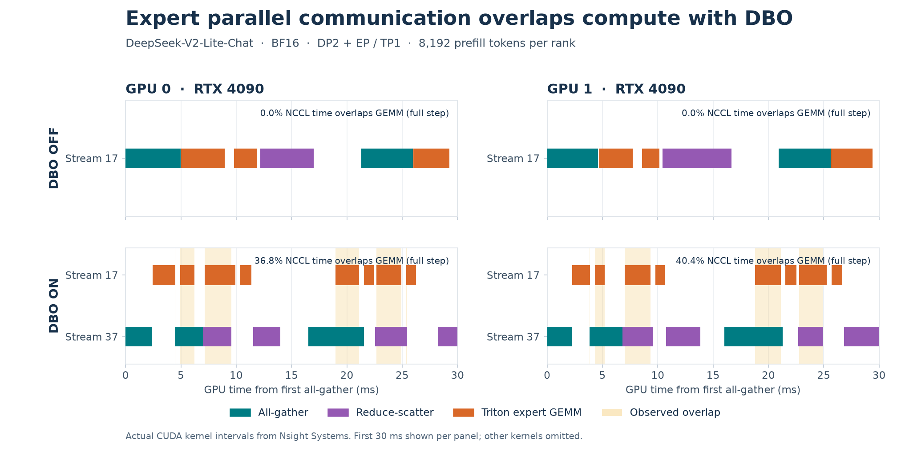
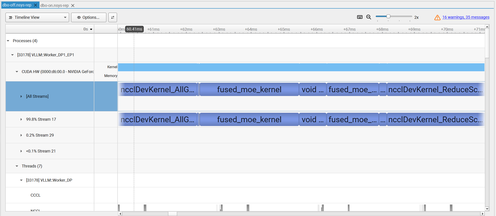
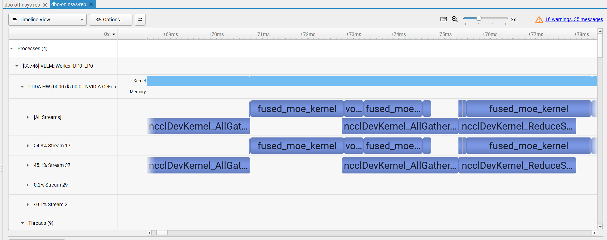

# vLLM：CUDA AG/RS 的双批次重叠（DBO）

为 vLLM Model Runner V2 的 `allgather_reducescatter` 后端实现 CUDA 双批次重叠（DBO），让一组微批的专家通信与另一组微批的专家计算并行。双 RTX 4090 上，DeepSeek-V2-Lite-Chat 在并发 64 的长输入场景中，请求吞吐提高 **6.9%**，P99 首 token 延迟下降 **7.0%**。

[上游 PR #68535](https://github.com/vllm-project/vllm/pull/68535) · [逐轮测试数据](experiments/agrs_dbo_pr/serving-trials.jsonl) · [实验汇总](experiments/agrs_dbo_pr/serving-summary.json)

## 推理服务压测

DeepSeek-V2-Lite-Chat（BF16），两张 RTX 4090，DP2 + 专家并行（EP）、TP1。每个请求输入 2,048 个 token、输出 8 个 token；每个并发和开关组合各测三轮，表中为三轮中位数。两组仅切换 `--enable-dbo`，纯 decode 批次均不拆分。

| 并发 | 吞吐（请求/秒，关闭 → 开启） | P99 首 token 延迟（ms，关闭 → 开启） |
| ---: | ---: | ---: |
| 32 | 14.93 → 15.42（+3.3%） | 2,104 → 1,970（−6.4%） |
| 64 | 15.97 → 17.07（+6.9%） | 4,022 → 3,739（−7.0%） |

并发 64 的三轮吞吐均有提升。并发 32 的吞吐波动范围重叠，生成阶段每 token 耗时的中位数增加了 17.5%。这些结果对应长输入、短输出的场景。

## Nsight Systems 时间线

每张卡在一个纯 prefill 步里处理 8,192 个 token。关闭 DBO 时，NCCL 和 Triton 专家 GEMM 在同一条流上串行；开启后，GPU 0 和 GPU 1 分别有 **36.8%** 和 **40.4%** 的 NCCL 活跃时间与专家 GEMM 重叠。下图从各自的第一次 AllGather 对齐，显示前 30 ms；百分比按整个 prefill 步计算。

展开 Nsight Systems 原图

**关闭 DBO（GPU 1）**：AllGather、专家 GEMM 和 ReduceScatter 在流 17 上依次执行。

**开启 DBO（GPU 0）**：流 37 上的 NCCL 内核与流 17 上的专家 GEMM 同时执行。

## 实现要点

沿用 MRV2 的双微批调度，将 MoE dispatch 的 AllGather 和 combine 的 ReduceScatter 放到通信流，专家 GEMM 留在计算流。用 CUDA event 保证通信与计算的依赖顺序，用 `record_stream` 防止跨流使用的显存被过早复用。CUDA Graph 捕获时，通信留在捕获流。

当前支持单机 DP + EP、TP = 1、模块化 MoE 和标准 NCCL（不启用对称内存）。已通过 130 项回归及双卡 prompt logprob 对比；验证使用的前置修复见上游 PR。

原 Qwen 实验环境与初始化说明见 [later.md](later.md)。
