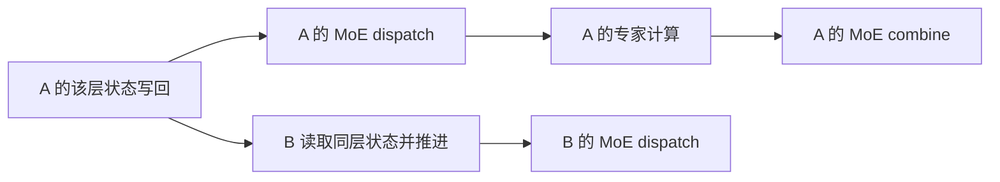

# vLLM GDN 与 Mamba 的 token 粒度 DBO 设计

在 Model Runner V2 内，将一次调度产生的 packed batch 切成两个连续 ubatch，允许长 prefill 在请求内部切开。两个 ubatch 在已有 MoE 通信交接点交错执行，使一个 ubatch 的专家通信有机会被另一个的 attention、GDN/Mamba、gate 或专家计算覆盖。跨界请求的两个片段按层读写**同一个整步工作状态块**，通用部分由 ModelState 管理，后端各自构建 kernel metadata。

当前状态为设计。源码基线是子模块提交 `9ad52f28fe`，源码树对应 vLLM v0.34.0，目录沿用 `vllm-v0.33/`。两个仓库使用 `GDN_Mamba_DBO` 分支。CUDA AG/RS 的通信实现及双 4090 测量来自独立候选补丁，接入当前基线后需重新验证。参见 [环境与初始化](later.md)、[AG/RS 候选与实验记录](experiments/agrs_dbo_pr/README.md)、[AG/RS PR #68535](https://github.com/vllm-project/vllm/pull/68535)。

## 支持范围

| 阶段 | 目标 |
| --- | --- |
| 状态接续 | CUDA、MRV2、两个 ubatch、非投机文本推理、eager、`mamba_cache_mode=none`。首批覆盖标准 GDN 和 Mamba2，验证纯 prefill、混合 prefill/decode 和纯 decode。 |
| 状态缓存 | 接入 `align`，先验证原有整步 pre-copy、块边界和 prefix hit，再接入后端的内部 checkpoint。 |
| 通信与部署 | 单机 DP2 + EP、TP/PP/PCP/DCP 均为 1。先证明状态与 metadata 正确，再运行具备异步 dispatch/combine 的 MoE 后端。验证 CUDA AG/RS 前需移植候选补丁及其前置修复。 |
| 扩展验证 | 异步调度、受支持的 decode FULL CUDA Graph。Mamba1 可复用公共 builder 接口，仍需验证 mixer 的状态读写与 padding。 |

以 GDN MoE（如 Qwen3.5 MoE）和标准 Mamba2（如 NemotronH 的 Mamba2 层）验证两种后端。KDA、ReplaySSM、RecoverSSM、投机解码与 Qwen4Exp 的 PLE/QSA 保留各自的准入限制。后续目标是在双 RTX PRO 6000 96GB 上部署 Qwen3.8-Flash-Next，组合验证 Intel W4A16、PLE CPU offload 和 MTP。

## 整步工作状态与片段 metadata

设请求在整步开始前已处理 `C` 个 token，本步调度 `N` 个 token。片段覆盖本步的 `[a, b)`，该片段的 query 长度是 `b-a`，已有上下文是 `C+a`，`seq_lens` 是 `C+b`。位置及普通 attention 的 slot mapping 取原 token 切片，page table 取原请求行切片。原请求进度、输出顺序和采样仍由整步管理。 [现有切片与合并][slice]

每层每请求的 `F` 是未切分执行时会更新的工作块。Mamba group 的同一个物理块 ID 可为不同层寻址，各层实际存储独立。GDN 和标准 Mamba 的 conv 与 SSM 使用同一个块 ID 寻址各自的缓存张量。原生整步预处理准备 `F` 后，A 推进到切点并写回 `F`，B 在实际 forward 中读到该状态，再写回整步终点状态。对于首次 prefill，A 使用零初态，B 必须读取 A 的状态。中间状态只在该步执行期间存于 `F`，块分配和释放仍由原 cache manager 管理。 [整步 pre-copy][hybrid-precopy] · [GDN forward][gdn-forward] · [Mamba2 mixer][mamba2-mixer]

例如完整 batch 的 query 长度为 `[1, 1, 64]`，按 token 33 切分。原第 2 行的 prefill 从位置 0 开始，Mamba block size 为 32，假设该行逻辑表是 `[null, 180]`。

| 视图 | prefill 请求行 | query 长度 | `seq_lens` | 初态位置 | 工作块 ID |
| --- | ---: | ---: | ---: | ---: | ---: |
| 整步 | 2 | 64 | 64 | 0 | 180 |
| A | 2 | 31 | 31 | 0 | 180 |
| B | 0 | 33 | 64 | 31 | 180 |

A 若按自己的 `seq_lens=31` 从逻辑表选块，会取到 `null`。B 若用现有计算 `mamba_aligned_state_indices` 的 GPU 捷径从局部第 0 行重新算，会读到完整 batch 的第 0 行。这两个问题分别由**按整步终点选块**和**按原请求行切片**解决。普通 attention 已收到正确的子表视图。 [逻辑表与整步输入表][block-table] · [aligned-index 计算][aligned-indices]

### 工作索引的准备与消费

1. `GPUModelRunner.execute_model()` 收集完整的 block tables/slot mappings，并对真实 batch 调用一次 `preprocess_state()`。`BlockTables.block_tables[gid].gpu` 按 worker 的持久请求槽编号，pre-copy 通过 `idx_mapping` 访问它。`input_block_tables[gid]` 是按本步 packed 顺序 gather 后的输入表。GPU context 在初始化时保存两类表的基址，aligned-index kernel 从后者的第 0 行开始读。 [runner][runner] · [context 初始化][hybrid-init]
2. `UBatchRunner.prepare()` 在 `create_ubatch_slices()` 后、逐片构建 metadata 前调用一次拟新增的 `ModelState.prepare_ubatch_attn_inputs()`。默认 ModelState 返回空额外输入。MambaHybridModelState 按 cache group 解析整步工作索引，再用各 `request_slice` 取相应行。跨界请求的原行同时出现在两个切片里，因而自然共享 `F`。 [UBatchRunner.prepare][ubatch-prepare]
3. `none` 从完整输入表的紧凑工作槽取索引。`align` 复用 `_mamba_ctx.compute_aligned_state_indices(full_batch.seq_lens, num_reqs)`，其工作列是 `max((seq_len-1)//block_size, 0)`。现有 fused context 假定 Mamba groups 共享缓存调度参数。索引以实际 cache group ID 交付，建立每 ubatch 的稳定缓冲，并按 real、dummy 和 padding 的元数据契约填充。缓冲存放块 ID，状态内容由层 forward 消费。 [状态索引 helper][block-table-helper] · [fused context][aligned-indices]
4. 每片继续调用 `_slice_input_batch()` 和 `MambaHybridModelState.prepare_attn(..., ubatch_idx=i, model_specific_attn_metadata=...)`。把 `ubatch_idx` 传给 `build_attn_metadata()`，由 `get_metadata_builder(i)` 使用已有的独立 builder 实例。拟通过 `MambaHybridAttnMetadata.get_extra_common_attn_kwargs(group_id, num_reqs)` 提供可选的 `mamba_working_state_indices`，与原始 `block_table_tensor` 并存。首版有显式工作索引时可跳过同 spec 的 metadata 复用。恢复复用时，`update_block_table()` 必须消费**当前 group** 的工作索引与独立的 checkpoint 目的块。 [hybrid builder 入口][hybrid-prepare] · [metadata 构建与复用][attn-build]

| 后端 | 工作索引接入 | 片段内继续沿用的语义 |
| --- | --- | --- |
| GDN | `GDNAttentionMetadataBuilder.build()` 优先用显式工作索引解析 `non_spec_state_indices_tensor` 和 `prefill_state_indices`。 | causal-conv 与 recurrent 同时接续。以 `seq_lens - query_len` 推导初态，校验首次 1-token prefill 的初始化及续填 1-token 尾段的 decode kernel。 [GDN builder][gdn-builder] |
| Mamba2 | `BaseMambaAttentionMetadataBuilder.build()` 用显式工作索引派生 `state_indices_tensor_p/d`。 | 采用片段级 `is_prefilling`、初态 mask、SSD chunk metadata。确认 `MambaMixer2` 在消费时读初态并写回同一个块。 [公共 builder][mamba-builder] · [Mamba2 metadata][mamba2-builder] |

沿用 MRV2 的 packed 请求顺序。非投机路径把 decode 形状和短 extend 放在长 prefill 前，后端根据片段 query 长度及原请求的 prefill 标志进一步分类。请求仍处于 prefill 时，它的续填尾段也可能满足单 token kernel 的条件。对消费位置的字段使用片段的有效起点，对调度进度使用整步字段。Eager 下零真实 token 的片段走 padding/dummy 路径，状态项使用后端规定的无效索引或专用 dummy 槽。 [请求排序][sort-requests] · [切片细节][slice]

## 执行次序与 DP/EP 协议

同一请求、同一层上，A 的 conv/SSM 写回必须先于 B 的读入。普通 attention 的 B 也依赖该层 A 的 KV 写入。两个执行线程共用 compute stream，复用 DBO 已有 MoE yield 和通信流事件。在启用某个 MoE 后端前，核对其正常和 padding 路径的交接顺序，确保每个相关层都由 A 先提交写入。metadata 可提前准备，状态 gather 在片段实际 forward 中进行。

图中箭头表示依赖。共享 compute stream 上按此前后关系提交即可建立状态依赖，无需逐层 CPU barrier。通信重叠还取决于后端、GPU 资源和 collective 事件。合并后的输出走一次整步采样、请求进度和后处理。第一阶段用同步调度验证，再核对 async scheduling 下连续两步的状态值和缓冲复用。线程 join 表示提交结束，跨步 GPU 缓冲的覆盖需受同流顺序或显式 event 保护。 [UBatchContext 与 stream 交接][ubatch-context]

复用 `dispatch_cg_and_sync_dp()` 的投票、最小 rank token 阈值、按最大 token 数 padding 和 per-ubatch `DPMetadata`。由配置准入允许通过验证的组合，并在模型初始化后检查实际 cache groups 与后端能力，用检查结果约束 `allow_ubatching`。所有 EP rank 一致选择执行方式、ubatch 容量和 collective 顺序，空片段所在 rank 也参加 collective。若合法性取决于 DP padding 后的切点，在提交 forward 前共同决定是否回退整步执行，每步只做一次原生 pre-copy。已更新状态后的失败沿 worker 错误路径退出。 [DP 协议][dp] · [配置准入][admission]

单请求只落在一个 DP rank 时，另一 rank 往往达不到默认阈值。低并发评估需要分别记录实际进入 DBO 的步数、各 rank 两片的有效 token 和 padding 比例。

## Prefix cache 与内部 checkpoint

`align` 的工作块 `F` 会被继续推进。对 allocator 为整步保留的 checkpoint 块，应写入对应位置的快照，供其它请求复用。当前 prefix caching 默认开启，Mamba 的模型配置会把 `none` 归一化为 `align`。是否使用内部导出还取决于所有 Mamba 层的能力及该步的合法性。Mamba2 能在 host chunk metadata 中插入边界，GDN 的内部导出由实际选择的 FlashInfer prefill 路径提供。可先在未安排内部导出的 align 路径验证整步对齐与 prefix hit。 [Mamba 配置][mamba-config] · [GDN checkpoint capability][gdn-checkpoint-capability] · [整步调度规则][scheduler-checkpoint]

1. **保留整步计划。** 复用 `compute_mamba_prefill_checkpoints()` 的整步位置和目的列规则，并与 `MambaManager` 实际保留的块对齐。对每个 checkpoint 保存原请求行、绝对位置 `P`、原目的列，由对应 group 的逻辑表取物理目的块。片段 `[a,b)` 在 `C+a < P <= C+b` 时负责写，局部 offset 为 `P-(C+a)`。片段 builder 消费显式投影结果，空计划表示该片无需导出。manager 的预留、校验和 prefix 发布语义仍按整步处理。 [checkpoint builder][checkpoint-builder] · [cache manager][mamba-manager]
2. **处理片段终点和卷积历史。** 若 `P` 就是 A 的终点，则可在 A 写完 `F` 后、B 覆写前，把完整 conv 和 SSM 状态复制到已保留的 checkpoint 块。片段内部导出还要验证卷积窗口。现有 exporter 在局部 offset 小于 `STATE_LEN` 时不写 conv 状态。优先选择合法切点，或由选定后端显式拼接片段入口的卷积历史与新输入；无法生成完整快照的切点走整步。 [卷积 checkpoint 写入条件][checkpoint-exporter]
3. **后端生成导出计划。** Mamba2 用局部 offset 生成 SSD chunk 边界及 `checkpoint_chunk_idx`。GDN 的现有 FlashInfer 规划器按相对 offset 求公约数，适用于能满足 64-token 对齐的调用。若原 checkpoint 位于合法绝对网格，可使用锁定版本 FlashInfer 0.7.3 原生 non-CP kernel 的 `prefix_lens`，以片段有效起点作为 prefix。间隔 `I` 需是 64 的倍数，片段长度为 `L` 时，输出数量为 `floor((prefix+L)/I) - floor(prefix/I)`。需要给 vLLM wrapper 传参，重建 `checkpoint_cu_starts`、选中行和 workspace 上界。 [Mamba2 builder][mamba2-builder] · [GDN 规划器][gdn-plan] · [vLLM FlashInfer wrapper][flashinfer-wrapper] · [FlashInfer 0.7.3 实现](https://github.com/flashinfer-ai/flashinfer/blob/v0.7.3/flashinfer/gdn_prefill.py#L1429-L1448)

例如请求处理到位置 250，整步在位置 192 保留 checkpoint，切点为 125。B 的局部导出 offset 是 67，使用 `prefix_lens=125`、`I=64` 会生成位置 128、192 的快照，只选用 192 对应的行。B 的最终状态仍写在 250 对应的工作块，两者间相隔 58 个 token。若后端无法覆盖原目的位置、卷积历史或 workspace 容量，使用全 rank 一致的整步退路。这样发布的 prefix 命中始终对应实际写出的完整状态。

## CUDA Graph 与模型专用输入

DBO 的捕获、replay 前输入准备和带 attention 的 dummy 都经过 `UBatchRunner.prepare()`。该入口需要处理匹配形状的 dummy block table 和空行。Replay 前更新每片的工作索引、query offsets 等持久 GPU 缓冲，保持捕获地址稳定。检查 dummy/profile 和 padding 的状态写入仅落在允许的槽。先验证后端已声明支持的均匀 decode FULL，混合 prefill DBO 采用 eager。当前 DBO 只为 FULL 候选捕获 ubatch 图，纯 PIECEWISE 会触发配置限制。 [图捕获入口][capture] · [GDN capture][gdn-capture] · [Mamba capture][mamba-capture]

Qwen4Exp 继续走显式准入。通用状态接续可服务其 GDN 和 PLE short-conv。PLE 另外要提供按片段生成的 n-gram context，或在整步生成 IDs 后按 token 切片，并为两片隔离 CPU offload 预取结果和生命周期。QSA 要验证按片段生成的逻辑上下文、压缩组、ring 与主 KV 的可见性。PLE/QSA 通过这些验证后才能解开对应模型配置的限制。 [Qwen4Exp ModelState][qwen-state] · [模型准入][qwen-guard] · [早期 Qwen 专项笔记（v0.31）](experiments/qwen38_token_ubatch_design.md)

## 实现与验收

1. **先验证状态链路。** 共用工作索引准备入口，接入 GDN、Mamba2 两种 builder。对照同一批的整步与串行两片，比较每 token 的 hidden states/logprobs、逐层 conv/SSM 末态和后续 decode。覆盖首次 prefill、续填、单 token 尾段、B 起始行非零、多个 cache groups、同列及跨列切分，并验证 dummy 后新请求复用槽位。按 dtype 设置误差阈值。接入交错执行后，再用同切点的串行执行区分切分舍入差异与执行次序错误。
2. **再接 prefix cache。** 从无内部导出的 `align` 开始，覆盖命中与未命中、状态 pre-copy、前缀在 A/B 间截断。随后覆盖 checkpoint 在 A 内、切点、B 内以及距离 B 起点不足卷积窗口的情形。对 checkpoint 做独立前缀重跑，并通过真实 cache hit 验证两类状态及下一 token logits。可扩展现有 [ubatch 切片测试][test-slice]、[GDN metadata 测试][test-gdn]、[Mamba metadata 测试][test-mamba] 和 [prefix-cache 测试][test-prefix]。
3. **最后量化重叠收益。** 在相同模型、scheduler、缓存预算和 attention/MoE backend 下比较三组。整步执行给出基线，相同切点的串行 A/B 测量切分成本，相同切点的 DBO 测量通信重叠增益。覆盖混合负载、单请求和长上下文，记录 TTFT、TPOT、吞吐/SLO goodput、峰值显存、准入率及 padding。用双卡 Nsight Systems 追踪 dispatch/combine 暴露时间、通信与计算重叠、状态读写和小 GEMM 的开销。再与原有实用部署配置比较，包括其可用的 CUDA Graph。只有两种状态后端都通过整步对照，才能声明公共协议获得验证。

[slice]: https://github.com/YuHanWu-Fox/vllm/blob/9ad52f28fe/vllm/v1/worker/gpu/ubatch_utils.py#L54
[hybrid-precopy]: https://github.com/YuHanWu-Fox/vllm/blob/9ad52f28fe/vllm/v1/worker/gpu/model_states/mamba_hybrid.py#L194
[gdn-forward]: https://github.com/YuHanWu-Fox/vllm/blob/9ad52f28fe/vllm/model_executor/layers/mamba/gdn/qwen_gdn_linear_attn.py#L2052
[mamba2-mixer]: https://github.com/YuHanWu-Fox/vllm/blob/9ad52f28fe/vllm/model_executor/layers/mamba/mamba_mixer2.py#L826
[block-table]: https://github.com/YuHanWu-Fox/vllm/blob/9ad52f28fe/vllm/v1/worker/gpu/block_table.py#L66
[aligned-indices]: https://github.com/YuHanWu-Fox/vllm/blob/9ad52f28fe/vllm/v1/worker/mamba_utils.py#L1086
[runner]: https://github.com/YuHanWu-Fox/vllm/blob/9ad52f28fe/vllm/v1/worker/gpu/model_runner.py#L1826
[hybrid-init]: https://github.com/YuHanWu-Fox/vllm/blob/9ad52f28fe/vllm/v1/worker/gpu/model_states/mamba_hybrid.py#L154
[ubatch-prepare]: https://github.com/YuHanWu-Fox/vllm/blob/9ad52f28fe/vllm/v1/worker/gpu/ubatch_utils.py#L356
[block-table-helper]: https://github.com/YuHanWu-Fox/vllm/blob/9ad52f28fe/vllm/v1/attention/backends/utils.py#L1286
[hybrid-prepare]: https://github.com/YuHanWu-Fox/vllm/blob/9ad52f28fe/vllm/v1/worker/gpu/model_states/mamba_hybrid.py#L249
[attn-build]: https://github.com/YuHanWu-Fox/vllm/blob/9ad52f28fe/vllm/v1/worker/gpu/attn_utils.py#L472
[gdn-builder]: https://github.com/YuHanWu-Fox/vllm/blob/9ad52f28fe/vllm/v1/attention/backends/gdn_attn.py#L329
[mamba-builder]: https://github.com/YuHanWu-Fox/vllm/blob/9ad52f28fe/vllm/v1/attention/backends/mamba_attn.py#L467
[mamba2-builder]: https://github.com/YuHanWu-Fox/vllm/blob/9ad52f28fe/vllm/v1/attention/backends/mamba2_attn.py#L161
[sort-requests]: https://github.com/YuHanWu-Fox/vllm/blob/9ad52f28fe/vllm/v1/worker/gpu/model_runner.py#L2579
[ubatch-context]: https://github.com/YuHanWu-Fox/vllm/blob/9ad52f28fe/vllm/v1/worker/ubatching.py#L107
[dp]: https://github.com/YuHanWu-Fox/vllm/blob/9ad52f28fe/vllm/v1/worker/gpu/dp_utils.py#L49
[admission]: https://github.com/YuHanWu-Fox/vllm/blob/9ad52f28fe/vllm/config/vllm.py#L3378
[mamba-config]: https://github.com/YuHanWu-Fox/vllm/blob/9ad52f28fe/vllm/model_executor/models/config.py#L1081
[gdn-checkpoint-capability]: https://github.com/YuHanWu-Fox/vllm/blob/9ad52f28fe/vllm/model_executor/layers/mamba/gdn/qwen_gdn_linear_attn.py#L898
[scheduler-checkpoint]: https://github.com/YuHanWu-Fox/vllm/blob/9ad52f28fe/vllm/v1/core/sched/scheduler.py#L563
[checkpoint-builder]: https://github.com/YuHanWu-Fox/vllm/blob/9ad52f28fe/vllm/model_executor/layers/mamba/checkpoint.py#L21
[mamba-manager]: https://github.com/YuHanWu-Fox/vllm/blob/9ad52f28fe/vllm/v1/core/single_type_kv_cache_manager.py#L1697
[checkpoint-exporter]: https://github.com/YuHanWu-Fox/vllm/blob/9ad52f28fe/vllm/model_executor/layers/mamba/checkpoint.py#L278
[gdn-plan]: https://github.com/YuHanWu-Fox/vllm/blob/9ad52f28fe/vllm/v1/attention/backends/gdn_attn.py#L38
[flashinfer-wrapper]: https://github.com/YuHanWu-Fox/vllm/blob/9ad52f28fe/vllm/model_executor/layers/mamba/gdn/qwen_gdn_linear_attn.py#L392
[capture]: https://github.com/YuHanWu-Fox/vllm/blob/9ad52f28fe/vllm/v1/worker/gpu/cudagraph_utils.py#L764
[gdn-capture]: https://github.com/YuHanWu-Fox/vllm/blob/9ad52f28fe/vllm/v1/attention/backends/gdn_attn.py#L807
[mamba-capture]: https://github.com/YuHanWu-Fox/vllm/blob/9ad52f28fe/vllm/v1/attention/backends/mamba_attn.py#L191
[qwen-state]: https://github.com/YuHanWu-Fox/vllm/blob/9ad52f28fe/vllm/models/qwen4_exp/nvidia/model_state.py#L23
[qwen-guard]: https://github.com/YuHanWu-Fox/vllm/blob/9ad52f28fe/vllm/model_executor/models/config.py#L1370
[test-slice]: https://github.com/YuHanWu-Fox/vllm/blob/9ad52f28fe/tests/v1/worker/test_gpu_ubatch_slicing.py
[test-gdn]: https://github.com/YuHanWu-Fox/vllm/blob/9ad52f28fe/tests/v1/attention/test_gdn_metadata_builder.py
[test-mamba]: https://github.com/YuHanWu-Fox/vllm/blob/9ad52f28fe/tests/v1/attention/test_mamba_metadata_builder.py
[test-prefix]: https://github.com/YuHanWu-Fox/vllm/blob/9ad52f28fe/tests/v1/core/prefix_cache/test_partial_prefix_cache_hits.py
