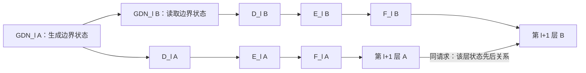

# Qwen3.8-Flash-Next token ubatch 设计

设计日期：2026-11-13。目标部署：Intel AutoRound W4A16、双 RTX PRO 6000 96GB、DP2/EP2/TP1、PLE pinned-host offload，逐步接入 MTP。

版本说明：项目现已迁移到 `vllm-v0.33`。本文保留设计时基于 v0.31 的源码核对记录；实施前需按当前 v0.33 基线重新核对相关路径与行为。

这是一份待实施、待验证的设计，不表示这些组合已获支持。当前仅新增本文档，未修改推理代码、加载模型或执行 GPU 验证。下文新增的数据结构、接口和能力字段均为拟议名称，不是现有 CLI/API。

本地源码基线为 `vllm-v0.31@8d02c91f2d`；同时核对了 2026-11-13 的上游 main，其查询到的 HEAD 为 `dfbda4bfc667d74e831075b6dbaf3caa5d659482`。前文所涉 v0.33/main 的功能不能直接假设本地 v0.31 已具备。例如，投机验证的请求对齐切分和整批 draft metadata 重建需要检查并移植对应改动。

非投机范围的补充核对：首版优先复用已有 token 切片、DP 协调和连续 chunk prefill 路径；下文数据结构是可选的显式表达，不要求全部新增。DP 空微批执行已有实现，不能把 hybrid padding 的适配写成重建 DP 协议。SSM 边界状态优先原位更新既有 cache slot，不要求增加独立 carry buffer。

## 1. 目标与实现边界

目标是对一次调度得到的 packed token batch 做两个连续切片，允许同一长 prefill 请求横跨切分点；两块运行完整的 decoder forward，在 MoE 通信处交错推进。scheduler 仍只提交一个逻辑 step，sampling、请求进度更新和 MTP drafting 均保持整批边界。

与只切 MoE 的方案相比，本方案会切分 GDN/QSA 的执行，增加状态与 metadata 适配，但能够用另一块的 GDN/QSA、gate 等计算覆盖通信。

第一阶段的合格范围：

- 文本请求、Qwen4Exp 模型路径、DP2/EP2/TP1，PP/PCP/DCP 均为 1。
- 两个连续 token ubatch；允许 prefill 请求跨边界，支持 prefill/decode 混合 batch。
- 同步调度、eager、prefix caching 关闭，不启用 MTP、RecoverSSM、LoRA、EPLB。
- 保留 BF16 PLE 表的 CPU offload，使用每 ubatch 独立的预取缓冲。
- 两个 ubatch 使用同一个 compute stream；通信使用后端提供的独立执行路径。CPU 线程按既有 DBO 协议交接，不能无序提交同一请求的 state 更新。
- 第一阶段复用现有 DP 准入/padding/dummy 路径，验证一侧零真实 token 时 hybrid state 不被错误更新；最终的混合负载目标必须覆盖 DP 不均衡。

第二阶段接入固定 K 的 MTP：decode 验证窗口、`prefill_runs_as_decode` 等可回滚窗口保持完整，prefill 的普通部分仍可按 token 切分。这里“token 粒度”明确指允许跨 prefill 请求内部切分，不承诺把任意 MTP 窗口也任意切开。

随后独立推进图执行、prefix-state caching、异步调度和更一般的投机窗口切分。前两阶段不能宣称已经支持这些后续组合。

## 2. 必须保持的语义

1. 每个真实 token 在 target 的每一层只计算一次；merge 后的 token 顺序与原 packed batch 相同。
2. 同一请求同一层的先段必须在后段读取持久状态前完成相关写入。依赖包括 GDN SSM/conv、PLE short conv、QSA compressor ring 和 main KV 可见性。
3. 请求的持久状态槽位属于逻辑请求，不属于 ubatch。两块同时存活的 metadata、异步预取结果和通信 handle 必须隔离；仅在同一 compute stream 上被顺序生产/消费的 scratch 可以复用，无须一律双份分配。
4. 切分不产生两个 scheduler step。全局 `num_computed_tokens`、acceptance、状态迁移、采样和统计按逻辑 step 更新一次。
5. 所有 EP rank 具有相同的 collective 调用序列；局部没有 token 不等于可以跳过该 rank 的 MoE collective。
6. GPU 依赖不能通过阻塞当前 ubatch 的 CPU 线程来等待另一 ubatch，否则可能阻止 producer 入队。前后段依赖必须构成无环的提交顺序和 CUDA 依赖。
7. 不能在一个已部分推进 recurrent state 的 step 上直接回退并重跑整批。fallback 必须在执行前完成；执行失败沿 worker 的失败处理退出，除非另有完整 rollback 协议。

## 3. Token 切分计划与请求片段

复用现有连续 token slice 和输入顺序。两个连续切片至多产生一个跨边界请求，因而首版不需要通用 token 重排系统。

增加显式的逻辑请求片段描述，避免只复制原 request-level metadata：

```python
@dataclass
class RequestSegment:
    request_index: int         # 原始逻辑请求索引
    token_begin: int           # 在完整 step packed input 中的位置
    token_count: int
    offset_in_step_request: int
    effective_computed: int    # C + offset；仅为片段视图
    logical_phase: str         # 原始 prefill / decode / verify 语义
    predecessor_ubatch: int | None
    is_first_segment: bool
    is_last_segment: bool

@dataclass
class TokenUBatchPlan:
    token_slices: list[slice]
    segments: list[list[RequestSegment]]
    real_tokens_by_rank_and_ubatch: object
    capacity_by_ubatch: tuple[int, int]
    split_signature: object    # 形状/能力类别，不包含 request ID
```

设逻辑请求 step 前已计算 `C` 个 token，本 step 调度 `N` 个 token，片段覆盖请求内本 step 的 `[a, b)`。子 batch 的契约为：

| 字段 | 片段值 |
| --- | --- |
| query length | `b - a` |
| effective computed tokens | `C + a` |
| sequence end | `C + b` |
| positions | 原始 token position 的切片，禁止重置为 0 |
| logical request/state slot | 原请求的身份及工作状态槽 |
| has initial state | 原有前缀或 `a > 0`，并按后端初始化契约处理 |
| prefill/decode/verify 分类 | 来自原始请求语义及支持的后端转换，不能只看片段长度 |

例如 `C=100, N=4096`，在请求内 2048 处切开：A 的 sequence end 为 2148，B 的 effective computed 为 2148、sequence end 为 4196。scheduler 的全局进度在 merge 前仍为 100；这些偏移不能回写全局 RequestState。

现有 `_slice_input_batch()` 已处理 query offsets 和部分 sequence-length 调整，但 `num_computed_tokens_np` 等字段仍直接按请求切片。需要逐项审计消费者，显式区分逻辑进度与片段进度；不能无差别改写所有原字段。

切分策略：

- 首版复用现有 DP-padded token midpoint 切点，而非按请求数或总 prompt 长度切分；仅在后续性能优化中考虑改变 padding/切点策略。
- 普通 prefill 内可切分；GDN kernel chunk 边界、QSA compression group 边界可作为性能偏好，不把未经证明的对齐条件作为普遍正确性要求。
- 固定 K MTP 接入后，verify 窗口和任何包含可回滚 placeholder 的特殊窗口作为原子单元。切点落入这些窗口时选择附近合法边界，或整步回退。
- 切点不必长期固定为 1:1。之后可用少量候选比例和测得的 stage cost 选择，但先实现可靠的 1:1 基线。
- 不在第一版改变 scheduler 的公平性、请求优先级或 prefill chunk 长度；ubatch 在本 step 调度结果之内工作。

### 3.1 现有 metadata 切分可复用的范围

非投机下，现有 `_slice_input_batch()` 的 query_start_loc 重基、片段 seq_lens/CPU upper bound、scheduled query lengths、token positions、request mapping 可以作为基础。`CommonAttentionMetadata.compute_num_computed_tokens()` 使用 `seq_lens-query_len`，已能为 B 推导 C+a；不应因 CPU 的 num_computed_tokens_np 仍保留整步起点，就统一改写全部进度字段。QSA 的 logical position 也使用这一长度关系，三套 cache 的请求行切片和完整 step 预分配的主 KV slot mapping 可复用。

但“原样切片 + 为 null 补块”不是完整的 metadata 适配：

- hybrid prepare_attn 仍有 ubatch_idx==0 保护，builder 选择固定 0，且调用 build_attn_metadata 时未传 ubatch_idx。需为两片段使用正确 builder；GDN、PLE、QSA 的同时存活输出不能互相覆盖。
- align GPU context 在整步 preprocess 时绑定完整 batch 的 block-table 基址；其 aligned-index kernel 以局部 rows 从 0 开始访问表。解除保护后直接用 B 的 seq_lens 调此 context，并不会自动把 rows 映射到 B 的 request_slice，因此存在选错原请求行的潜在错误。该 context 的 aligned_state_indices 输出也只有一套缓冲，构建 B 可能覆盖 A。需显式传请求行映射/使用正确子表，或整步预计算后按原请求行抽取到 per-ubatch 索引，并覆盖跨界请求的 M/F 索引。这里描述的是解除现有保护后的适配缺口，不是已支持路径的运行故障。
- M 的分配和状态寻址补齐后，初始状态来源与最终写入索引仍要在 wrapper/metadata 协议中表达；原 GDN prefill 用同一个索引读写，不能自动实现 B 从 M 读、向 F 写。既有整步 align precopy 也不能直接重复执行为两次 scheduler step。
- Qwen model_inputs 中的 query_start_loc/ngram_context 不在通用 slice_model_inputs 的切片名单；PLE 的前缀 context 从全局 GPU 请求进度读取，B 必须改用片段有效起点并纳入当前 step 内 A 的 token。需要 per-ubatch 模型输入准备，以及正确生命周期的预取缓冲。
- 同列切点、1-token prefill 尾段及 padding/空块需验证 kernel 分类和状态 mask；sampling 字段保留整批并仅在 merge 后消费，不要为了局部 forward 修改全局采样索引。

建议 metadata 验收至少包含：同请求 A/B 的有效上下文与位置；A 真正读取哪个初始槽、写入哪个槽；B 同样的 source/destination；B 的本地第 0 行映射到原 batch 的正确请求；构建 B 后 A 的 metadata 不变；PLE B 的 n-gram context；padding 不能推进真实状态。完成这些适配后才能将“补临时块”的存储方案与现有通用切片组成可验证的非投机实现。

### 3.2 三条路径的具体差异

以下以工作区 v0.31 的非投机 align 路径为准。假设 block size 16、query 为 64 token、A/B 各 32，补块后某请求行是 `[null, M, null, F]`。`mamba_get_block_table_tensor()` 根据 `(seq_lens-1)//block_size` gather，所以 A 的 `non_spec_state_indices_tensor`/`prefill_state_indices` 为 M，B 为 F。`QwenGatedDeltaNetAttention._forward_core()` 的 prefill 分支同时以 `prefill_state_indices` gather initial_state 和 scatter last_recurrent_state；底层 chunk kernel 只得到已 gather 的 initial_state，不读取完整 block table。A 因而直接写 M；B 默认读写 F，不会向前搜索 M。`has_initial_state=True` 仅控制是否使用所选块内容，不改变来源块。整步 preprocess_state 在 ubatch prepare 前执行，不会在 A/B 之间自动完成 M→F 的逐层迁移。

普通 attention 的路径是 UBatchRunner.prepare → `block_table[request_slice]` → DefaultModelState.prepare_attn → build_attn_metadata → CommonAttentionMetadata.block_table_tensor → FlashAttentionMetadataBuilder.build → FlashAttentionMetadata.block_table，request slice 的 tensor view 已包含正确起始地址。hybrid align 优化路径则由 preprocess 初始化整批 context 的 block-table 基址，prepare_attn 通过 compute_aligned_state_indices 把预计算索引交给 GDN builder，并优先使用这一旁路；局部长度并不自动改变 context 的表基址或行映射。这是解除 hybrid 保护时需要适配的上下文假设，普通 attention 的子表传递路径不受它影响。

PLE host offload 的只读权重可以由两块共享读取，但 lookup ID 由 `Qwen4ExpNGramEmbedding.compute_ngram_ids(input_ids, query_start_loc, ngram_context)` 生成。例如 trigram、A=[x0,x1,x2,x3]、B=[x4,x5]，B 的 prefix context 应是 [x2,x3]，不能沿用整步起点的历史。现有 `_prepare_ngram_context()` 从 req_states 的全局 GPU computed count 取 context，而 `slice_model_inputs()` 不处理 query_start_loc/ngram_context，CPU 权重位置不会修正这些输入。重叠 lookup 也需管理 `_prefetch_ids` 和 `_prefetch_buffer` 的独立生命周期；short-conv 的 hidden-state 历史仍需按请求衔接。

非投机下可考虑更少改动的 PLE 备选：整批先按原完整 query_start_loc/ngram_context 计算每个 PLE 层的 n-gram IDs，再按 token_slice 把预计算 IDs 交给两块各自 lookup。完整 IDs 本身在本 step 内不可变，可用切片视图；该方式需要新增预计算 IDs 的传递/消费接口，但可以避免为每块重建 n-gram 上文。lookup 输出缓冲和 short-conv 状态依赖仍需适配。

## 4. 层内状态衔接与交错调度

对于同一请求 `r`、GDN 层 `l`，必须满足：

```text
输入状态 S(l,r,C)
  -> GDN_l(A) -> S(l,r,C+a)
                  -> GDN_l(B) -> S(l,r,C+N)

GDN_l(A) 完成后：其 MoE dispatch 可以与 GDN_l(B) 重叠。
GDN_l(B) 不需要等待 A 完成整个模型。
```

依赖关系示意，D/E/F 分别为 dispatch、routed experts、combine：



箭头表示依赖，不表示各节点自动并行；能否重叠还取决于共享 compute stream、通信后端和可用 GPU 资源。PLE/QSA 的相应状态依赖也需加入同一 DAG。

首版采用共享 compute stream，保证每一层 A 的状态操作先于 B 排入流，并记录/检查提交顺序。不能仅假设“线程 0 最先启动”就足以证明所有层满足该条件：需检查各通信后端的 yield 路径和空 ubatch 路径。

若已有 DBO schedule 保持这种层序，状态正确性不需要再增加逐层 host barrier；同流顺序即可建立 GPU 依赖。若后续使用多个 compute stream，则加入按层/跨界请求的 producer-ready event，并保证 producer 已先提交。禁止 B 在唯一 compute stream 上等待尚未排入其前面的 A，形成环。

GDN 初始状态的 gather 必须留在该片段实际 forward 中，不能在提前构建 B 的 metadata 时拷出旧状态。A、B 的 metadata 可以提前构建，但 B 读取的是 A 已更新的 live state。

### 4.1 GDN 和卷积状态

prefix caching 关闭时，两个片段可按序更新同一请求独占的 live SSM/conv 槽位，不必为整个 GDN 输出建立传输缓冲。B 的 `has_initial_state` 必须正确，即使逻辑请求原本从位置 0 开始。

`mamba_cache_mode="none"` 的非投机路径可让两片段的 block-table 行解析到同一个 state index。A 的 final state 写回 `self.kv_cache` 后，B 的 prefill gather 直接读取；边界状态已存在于现有 cache pool，无须创建新 block 或让 scheduler 认领新的边界。这里的 cache 是通过 MambaSpec 管理的 SSM/conv state storage，并非普通 attention 的逐 token K/V。底层 chunk GDN kernel 接收显式 initial/final state，但现有 layer wrapper 通过 cache indices gather/scatter；若选择外部 carry buffer，需要改 wrapper 或复制到既有 slot，不能期待原 wrapper 自动访问外部地址。

`preprocess_state()` 在两个 ubatch 之前运行一次；`postprocess_state()` 和请求进度更新在 merge/采样之后按既有协议运行一次。不能对两个片段重复执行整步状态迁移。

按 ubatch 隔离 GDN、Mamba、PLE metadata builder 的 scratch；将 `get_metadata_builder(0)` 和 `build_attn_metadata(...)` 的单实例假设扩展为对应的 `ubatch_idx`。持久 state pool 仍按请求/层访问，不能复制成两份互不衔接的请求状态。

### 4.2 PLE 需要同时处理三类对象

| 对象 | 所有权与处理方式 |
| --- | --- |
| CPU n-gram 权重表 | 不可变，可继续在 DP rank 间共享 |
| n-gram IDs、预取输出、ready events | 按 PLE 层和 ubatch 隔离 |
| short-conv state | 同请求按 A→B 衔接，不能按 ubatch 复制后独立推进 |

对片段 B，n-gram 上文为“step 前上下文 + 本 step 请求 token 序列”中 B 起点之前的 `ngram_size - 1` 个 token。即便 B 位于本 step 内部，也不能仍使用原始 step 开始处的 n-gram context。应从完整 step 的 `input_ids` 取内部 token；这些 token 将来可能包括 draft proposals，不能假设它们已经存在于 committed `all_token_ids`。

准备 n-gram context 只依赖 token IDs，因而可提前进行，不需要等待 A 的 hidden states。PLE short conv 的历史则依赖其实际输入，需要等待 A 的对应计算。

新增模型专用的 ubatch 输入准备接口，例如：

```python
prepare_ubatch_model_inputs(full_batch, segment_batch, plan, ubatch_id)
```

返回本片段的 `query_start_loc`、`ngram_context` 与通用 token views；不能依靠现有 `slice_model_inputs()` 只切 `input_ids/positions`。

将 `_prefetch_ids`、`_prefetch_buffer` 扩展为两个独立槽位；使用 `input_ready[u]`、`lookup_done[u]` 精确表达依赖。消费者等待自己的 `lookup_done[u]`，避免 `wait_stream()` 把另一 ubatch 后续预取也纳入等待。首版可共享一个预取 stream，但每个 slot 复用前必须确认上一使用周期已结束。

### 4.3 QSA 不仅是 query 切片

需同时适配 main KV、raw index-key compressor ring、compressed-key cache、逻辑位置、top-k workspace 和 metadata builder。

- A/B main KV 写入原请求的不同绝对 token slots；B 允许读 A 已写好的前缀，A 不得看到 B 的未来 token。
- 同请求的 raw-key ring 可能复用同一物理槽位；A 的相关读取完成后，B 才能继续更新。
- QSA 的压缩组可能横跨切点。已有 reference kernel 支持从 ring 与当前 raw rows 拼出组；需要分别验证实际使用的 fused/reference backend，不能据此直接放开所有后端。
- 首版可以优先选择绝对位置落在 compression-group 边界的切点，但最终“任意 prefill token 切分”验收必须覆盖跨组边界。
- M-RoPE positions 原样切片，request-relative logical positions 由片段的有效起点推导；两者不能混用。

QSA 可直接沿用同一请求两次连续 chunk prefill 的算法和缓存：三套 cache 的原请求 block-table 行保持一致，第二片段使用已修正的 query/sequence-length metadata。现有 `_logical_positions()` 从 `seq_lens-query_len` 推导有效起点，已覆盖这一核心需求，不必为了 QSA 再重复构造一套请求进度。压缩边界和 ring 是验证项，不代表必然要重写 kernel。

QSA builder 返回且同时存活的 metadata 缓冲按 ubatch 隔离；公共 cache storage 保持按逻辑请求共享。模型级 top-k scratch 若始终在同一 compute stream 内生产/消费、区间内没有 yield，可以复用。shared compute stream 的 A→B 顺序需要覆盖 ring 更新和读取的完整区间。

## 5. DP 协议、空 ubatch 与 MoE 后端

### 5.1 首版直接复用 DP 协议，单独评估准入覆盖率

`sync_cudagraph_and_dp_padding()` 已跨 rank 协调 ubatching 准入、最大 padded token 数和图模式；随后各 rank 按相同 padded token midpoint 切分，`_make_forward_contexts()` 已设置每个 ubatch 的 DPMetadata。现有实现也明确允许空微批作为 dummy 执行。因此，非投机首版不新增每块 token-count handshake，不重写 collective 调度。

现有准入使用所有 rank 的最小 token 数检查 DBO threshold。非 uniform-decode 的默认 prefill threshold 为 512；一侧 4096 token、另一侧 16 token 的混合负载会被此阈值挡住。另一个判断 `2*min_tokens < padded_tokens` 只禁用相应图并转 eager DBO，不等于禁止空第二块。必须区分 threshold 准入、图选择和空块运行这三件事。

首版保留默认策略，只统计触发/fallback；之后可先通过已有阈值配置做实验。若需要更灵活的不均衡准入或各 rank 的独立切点，再修改相应策略/控制信息，并测量 padding 浪费。

新增的 hybrid 责任是：真实 query 为零时，GDN/PLE/QSA 不得推进任何真实请求状态；PAD/null block 映射正确。局部空块仍参与既有 MoE collective，不能跳过远端 expert work。无需因为复用相同请求行就强制分配新 state buffer，应由 query-length/slot mask 正确表达空操作。

所有 rank 的 collective 次数、类型和顺序继续由已有 DBO 协议保证。若模型局部能力检查需要回退，复用已有跨 rank `allow_ubatching` 投票，不让一个 rank 自行回退。

### 5.2 双卡 PCIe 的通信适配是独立前置任务

优先验证实际可用的 NCCL `allgather_reducescatter` + W4A16 expert backend。不能假设 RTX PRO 6000 配置能够直接使用 DeepEP/NVLink 专用路径，也不能仅修改配置白名单。

需实现/验证 compute→comm 依赖、通信完成 receiver、ubatch 切换，以及输出 buffer 生命周期。输入 ready event 必须在另一块无关计算入队前截取，避免通信错误地等待整个 compute stream 尾部。

通信/计算状态按 ubatch 私有化：dispatch handle、scales、top-k metadata、shared-output slot、workspace。A 的 combine 未读完的 expert 输出不能被 B 覆盖。现有 DBO handle/SharedExperts 双槽可复用，但必须核对所有后端分支。

暖机需覆盖每个 ubatch workspace lane 的真正最大 expert 输入。NCCL all-gather 后的行数可能为 `DP × local capacity`，不能仅按本地半批预留。target W4A16 与未量化 MTP 的 backend、workspace lane 也需要分别配置。

现有 naive DP/EP 路径的 ROCm DBO 支持和 CUDA 的准入不同；某些图路径即使能够重放，也会把 collective 放回同一流。必须分别验证“支持 graph”和“graph replay 中确实发生 overlap”。

## 6. MTP、prefix cache 与 CUDA Graph 的扩展

### 6.1 固定 K MTP：先只切 target

```text
step 级状态预处理
  -> target UB0/UB1 交错验证
  -> 按原 token 顺序 merge hidden / auxiliary outputs
  -> 整批 rejection sampling
  -> 沿既有协议提交状态与更新逻辑进度
  -> 整批 MTP drafting
```

这里为语义阶段图；具体 state commit 是当步执行还是下一步 precopy，沿用所选后端既有生命周期，不另造 acceptance 计数约定。

- 初版完整保留单个请求的 `K+1` 验证窗口。prefill 请求可跨块，verify 窗口和可回滚的特殊 prompt-tail 窗口不可跨块。
- target 产出的多分支 HC hidden 和 auxiliary tensor 按 token 维恢复，采样使用完整 batch 原来的 `logits_indices`。
- 根据当前 speculator 契约重建 drafting 使用的 full-batch attention metadata；不能传入某一个 ubatch 的 builder buffer。
- sampling/rejection 按原逻辑请求执行一次；检查各位置拒绝、全部接受、EOS/stop、请求重排与新旧请求混合。
- 兼容原生 GDN/PLE 的 speculative state slots；第一阶段不同时引入 RecoverSSM。

若以后允许 verify 窗口本身跨 ubatch，则需要 global draft-position→state-slot 映射、每个候选位置的 GDN/conv 恢复记录、QSA tentative ring 生命周期以及跨块 commit plan。仅传 A 的最后一个状态不够，因为 rejection 可能选择 A 内的任意位置。该能力是独立里程碑。

### 6.2 Prefix-state cache：独立处理 checkpoint 与 live state

在 `align` 或共享 prefix checkpoint 下，不可用 A 的边界状态覆盖多个请求共享的缓存快照。

已核对的具体障碍：`MambaManager.allocate_new_blocks()` 在 align 模式按完整 scheduler step 的结束位置分配工作块，跳过的中间逻辑列填 null（另有显式 checkpoint 等例外）。例如新请求本轮 64 token、Mamba block size 16、无 checkpoint，表可以是 `[null, null, null, p]`。若 A/B 各 32 token，沿用按片段 `seq_lens` 选择状态列的 builder，则 A 查列 1，命中 null。只有一次 scheduler 分配的两个 ubatch，不等同于各经过一次分配的两个 scheduler prefill step。

待验证的优先修法是解耦“片段的有效 token 位置”和“本轮的物理工作状态索引”：完整 step 预处理后取得本轮已分配、独占的最终工作槽 p，两个片段的 GDN/PLE state metadata 都显式绑定 p；A 写回中间状态、B 接续更新，完整 step 后 p 才持有最终状态。QSA/主 attention 的 seq_lens/slot mapping 仍使用片段视图，不可为复用 p 而把 A 的长度伪装成整批长度。GDN 已有 aligned-state-indices 注入点可作为扩展基础，PLE 等路径需相应支持显式工作状态索引；所有这些索引缓冲要避免被另一片段的 metadata 构建覆盖。

上述方案是设计假设，不表示现有代码已支持。必须复核 p 的 COW、引用和发布时机，确保不能被其他请求当作已完成 checkpoint 使用；原有 checkpoint 输出位置和回收仍遵循逻辑 step。任意位置 checkpoint、额外恢复点或不兼容后端如需单独块，才进一步修改 Manager 的容量计数、分配、回收、scheduler→worker 传输与 checkpoint 计划。null 本身不是必须物化的状态历史。

建议将跨界请求的工作状态与 prefix checkpoint 明确分开：step 开始按既有 COW/迁移语义准备 live state，A→B 在 live state 内推进，只有命中真实逻辑 checkpoint 边界时才发布快照。可以在既有 pool 中预留工作槽，或为 kernel 提供独立 initial/final state；必须测量额外内存和拷贝。

对连续二分，跨界请求最多一个，carry 状态数量可控，但每个 GDN/PLE 层都需要对应状态。ubatch 切点不是新的 prefix-cache 边界。一个请求在 A、B 中各出现一次，也不能触发两次整步 precopy/postcopy。

初版可以对跨越未支持 checkpoint 边界的 step 回退；之后通过独立 commit plan 覆盖多边界、COW、slot reuse 和 MTP acceptance 恰落边界等情况。

#### 可选实现：wrapper 使用临时状态块

“额外 block + GDN wrapper”可行，但容量检查、物理块所有权和片段状态衔接需要分开：

1. `get_num_blocks_to_allocate()` 只是可分配性预测，不会真正占用块。预留必须落实为 scheduler/engine-core 侧实际分配并持有 block reference，或由统一 allocator 维护会从后续准入中扣除的 reservation；首版优先前者。不能让 worker 中的第二个 manager 独立从同一全局 pool 取号。
2. scheduler 通过拟议的 step 级 `scratch_state_leases` 传递 lease/step ID、相关 cache group 和物理 scratch block ID；这些块在分配时不绑定 request ID、token 边界或 block-table 逻辑列。runner 完成 DP/graph 协调和切分后，本地确定跨界请求及逻辑列，才把物理 ID 绑定到临时 metadata。scheduler 不需要提前知道切点，也不提前替换 request table 中的 null。若切点未知，可保守提供候选 scratch，但不要在所有请求的计数中无条件 +1。连续二分至多有一个跨界请求，每个参与的状态 cache group 至多需要一个独立边界块；多 in-flight step 需分别持有租约。
3. scratch block 用独立 sidecar 记录所有权；wrapper 用 per-ubatch 的索引/局部 block-table overlay 绑定它。避免往持久 request table 插入再删除，也不把它发布为 prefix checkpoint。若确需修改持久表，必须同步 CPU/GPU 映射与更新协议；本地存在整行 block_table_updates，但它不是跨版本通用接口。
4. 仅用 scratch q 替换 null 不足以交接状态。当前 GDN wrapper 大多按同一索引读写状态，若 A 使用 q、B 使用最终工作槽 p，续算请求需在该层 A 前把初始 SSM/conv 从 p 准备到 q，并在 B 前把 A 的输出从 q 交接到 p。可先用同流 copy 作正确性实现；之后评估显式 initial/final indices 以减少拷贝，但需连同 conv 路径一起适配。不能等 A 整个模型结束才为全部层统一迁移，否则会破坏预期交错。
5. `forward()` 的 Python 返回不等于 GPU 最后使用完成。scratch 在完整 step 的最后读写完成后沿现有 completion 协议归还 scheduler-owned pool；异常/取消/抢占也走同一 lease 状态机，禁止提前释放、双重释放。不得为此引入逐层 host RPC 或 cuda.synchronize。

物理块分配与逻辑位置绑定是两个阶段：例如 scheduler 借出 group g 的物理块 37，runner 之后才决定将其用于请求 r 的逻辑列 1。若最终不启用 DBO，或没有跨界请求，则该租约不使用并沿 step 完成路径归还。没有 scratch 时可通过已有 allow_ubatching 投票一致关闭本轮 DBO，不能单个 rank 在 collective 开始后自行回退。该额外资源更适合在 step 级预算/租约中表达，而非强行塞入每个请求的 MambaManager 分配计数。

另一条可选路径是在 KV cache 初始化/显存预算阶段划出 worker 独占的固定 scratch arena，按 cache group 和并行执行槽管理，并从 scheduler 可分配容量中扣除或使用独立存储。这样 runner 可完全本地选择切点、绑定、复用；worker 内的小 allocator 只管理其独占 arena，不触碰 scheduler 全局 pool。固定 arena 应纳入实际显存 profiling、cache/kernel 的地址与索引约束以及 graph 生命周期；不能凭空使用全局池中的空闲 block ID。

若由 UBatchRunner 持有自己的 scratch manager，推荐在初始化时明确独占的物理 ID/存储区域。以单一池为示意，worker 实际存储容量为 N、scheduler 可分配容量为 N-R、预留尾部 R 个 ID 由 scratch manager 管理；初始化接口必须保留两种容量，不能把所有地方的 num_blocks 都改成 N-R，导致 worker 没有为 scratch ID 分配实际存储。多 pool/不同 cache group 按实际布局分别处理。此方式不需要每请求下发临时 block，也无需每请求 get_num_blocks_to_allocate 加一；get_num 的 headroom 检查无法代替物理 ID 所有权划分。UBatchRunner 每轮只在独占区 acquire/bind/release，并按 GPU 最后使用完成条件复用。

对固定两个 ubatch、非投机、同步执行的首版，以上局部 scratch manager 优于每步 scheduler 租约：临时资源需求有界、无逐步 block-ID 传输和归还通知；代价是常驻占用少量状态容量及初始化接口适配。若后续需要在常规 KV 与临时状态之间动态借还容量，step 租约更灵活。两者都不要求 scheduler 知道切点。每步租约通过调度输出的 step 级字段传递即可，也不需要绑定到每个请求的 block_ids。

2026-11-14 补充 async scheduling：scheduler 的多步在途/结果未回收不等于 worker 有多个无序访问 scratch 的 model forward。已核对的 MP worker 逐个执行 RPC，UBatchRunner.run() 会 join 本轮线程；GPU 工作仍可能未完成，但相同 compute stream 的后续覆盖排在前轮最后读取之后。因此，对 PP1、非投机、两个连续 ubatch、单个 worker 执行序列，每个参与的状态 cache group 一个 scratch slot 可以逐轮复用，无须按 engine batch_queue 深度扩容。

这个结论要求上一轮跨界请求的最终状态及持久索引留在正式工作槽 F，scratch M 只在 forward/明确的状态交接中使用；所有 M 的初始化、拷贝和最后消费与下一轮覆盖具有 GPU happens-before 关系。线程 join 不代表 GPU 完成，也不需要为了这种同流复用新增 cuda.synchronize 或等待 scheduler 消费结果。异步 D2H 输出不应引用 M；若未来将 M 用于另一 stream 的 checkpoint/offload，应在复用前建立 event 依赖，或增加 slots 以允许该部分并行。GPU scratch 可以单份，不代表被异步输出持有的 CPU metadata 也可以原位改写。

容量应按“最多有多少个不能按 stream/event 顺序复用 scratch 的执行实例”估算。对连续 U 分块，保守上界为每组 C*(U-1) 个槽，C 是这样的并发使用实例数；当前上述执行假设为 U=2、C=1。多个 scheduler output 排队或 async output 尚未返回，本身不增加 C。capture/warmup 与服务并行、多个独立执行流、PP 等更复杂拓扑需重新核对，不直接沿用该上界。

如果 A/B 终点落在同一逻辑列，或切点本来已有非 null block，不能覆盖该 block 的所有权。临时索引覆盖或明确 fallback 更安全；新块内容必须正确初始化，绝不能在 NULL_BLOCK_ID 上实际写入。GDN 的 SSM 和 causal-conv 状态均需处理，PLE short-conv 是另一个独立适配项。

这个方案适合作为状态索引复用的备选原型，但需要与“整步工作槽 p 原位衔接”的版本比较状态 copy 时间、metadata/control 开销、显存占用和最终 goodput。额外分配块本身不会自动增加通信隐藏，收益来自 DBO 交错。

### 6.3 图执行：从可捕获的形状类别推进

固定形状 uniform decode/verify 是优先目标；任意混合 prefill 先保留 eager 路径。GDN/QSA 支持哪类 graph 必须以实际 backend 声明和 capture/replay 测试为准，不能仅解开 PIECEWISE 白名单。

持久 GPU buffers 保存 `effective_computed`、segment offset、continuation mask、request mapping、state indices、ngram IDs 和 events。capture 不可把某个请求 ID 或初始切分点冻结为运行时常量。

graph registry 区分两块容量、request 容量、执行类别、verification 长度上界和 backend；不为每个具体请求或精确切点建图。replay 前更新数据，不替换 storage 地址。

需要保证 PLE 异步 fork/join 与 capture 生命周期一致；外部预取结果保持稳定，跨图依赖须由受支持的事件协议表达。两块都使用同一 PLE graph-pool 临时地址会造成静默数据错误。

“breakable/PW + token DBO”是额外架构工作。若同一步既有 GDN eager 区又有跨流通信，不应假设现有 per-ubatch graph wrapper 可以直接组合；需验证完整事件 DAG 或引入明确的分段捕获协议。

## 7. 源码改动清单

以下路径相对于本地 `vllm-v0.31/`。上游 main 已将部分 QSA 代码拆分/改名，实施时应固定基线，不在两套路径之间混改。

| 文件/区域 | 拟议改动 | 必须保留的边界 |
| --- | --- | --- |
| `vllm/config/vllm.py`、`config/parallel.py` | 增加显式 opt-in 与所选模型/后端能力准入 | 其他 hybrid/多模态组合不自动放开 |
| `vllm/v1/worker/gpu/ubatch_utils.py` | TokenUBatchPlan、RequestSegment、片段输入准备、merge | 一个逻辑 step 与原 token 顺序 |
| `vllm/v1/worker/gpu/dp_utils.py` | 首版复用现有准入/padding/dummy；仅在覆盖率不足时调整策略 | 不新建 DP 协议；一致 collective 序列 |
| `vllm/v1/worker/gpu/model_runner.py` | 整步状态 hooks、UB forward、full-batch spec metadata 衔接 | sampling/drafting 按整批执行 |
| `vllm/v1/worker/gpu/model_states/mamba_hybrid.py` | per-ubatch builder、片段 phase/acceptance/state 映射 | 全局逻辑进度不受片段视图污染 |
| `vllm/models/qwen4_exp/nvidia/model_state.py` | 每片段 `ngram_context/query_start_loc`，准备接口 | 继续使用原请求的历史与 token IDs |
| `vllm/models/qwen4_exp/nvidia/ngram_embedding.py`、`common/ngram_embedding.py` | per-ubatch IDs/output/events 与生命周期 | CPU 权重表保持可共享 |
| `vllm/models/qwen4_exp/nvidia/ple_layer.py`、`v1/attention/backends/short_conv_attn.py` | PLE conv continuation、独立 metadata | 真实 conv state 按请求与层衔接 |
| `vllm/model_executor/layers/mamba/gdn/qwen_gdn_linear_attn.py`、`v1/attention/backends/gdn_attn.py` | 审计 initial/final state 和片段初始化；必要时增加显式 state 参数 | 首版优先复用 kernel，不先重写 GDN 算法 |
| `vllm/models/qwen4_exp/common/qsa_cache.py`、`nvidia/indexer_qsa.py`、`nvidia/qsa.py` | ring/KV/压缩组的跨片段语义、workspace 隔离 | causal mask、逻辑位置、request slot 不变 |
| `vllm/model_executor/layers/fused_moe/prepare_finalize/*`、workspace manager | CUDA 后端异步生命周期、两块 workspace/handle | 原权重、路由语义与 dtype |
| `vllm/v1/worker/ubatching.py` | 检查依赖层序、异常退出；有证据时增加依赖调度 | 无 CPU 等待环，不额外创建每层线程 |
| `vllm/v1/worker/gpu/spec_decode/*` | fixed-K target UB 后重建 full metadata、复用现有 sampler | 初版不切 drafter，不切 verify window |

调度层第一版只提供本轮已调度 token 与 phase 信息；不必首先改写 `scheduler.py`。自适应 split/准入策略在正确性与成本测量完成后再接入。

## 8. 验收、性能与实施顺序

### 三条执行对照

- A：现有整批执行，作为模型/任务质量及实际性能基线。
- B：相同 token 切点、相同 kernel shape 的两块严格串行执行，作为片段语义基线。
- C：相同两块交错执行，作为待验证实现。

先验证 B 对 A 的片段语义，再验证 C 对 B 的并发正确性。GDN 的分块可能改变浮点运算顺序，不能无条件要求 B 与 A 长生成逐 token 完全相同；应检查高精度 reference、各层状态误差和模型评测。C 对 B 使用相同切分，要求尽可能严格的输出/状态一致性；不能通过放宽误差容忍掩盖跨请求状态或 metadata 错误。

### 必须覆盖的失败模式

| 测试范围 | 关键场景 |
| --- | --- |
| 片段 metadata | C=0/C>0、切点前后各 1 token、1-token prefill 尾段、跨请求边界、padding |
| GDN/conv | A 状态先于 B、不同请求槽不互写、请求重排、slot 回收重用、连续多 step |
| PLE | 片段 B 的 n-gram 上文、短请求/EOS padding、延迟 B/A lookup、预取 buffer 毒化 |
| QSA | compression ratio 各余数、ring wrap、KV block 边界、M-RoPE 与 causal selection |
| DP/EP | 一侧长 prefill/另一侧 decode、某块 0 token、完全 idle rank、非偶数请求、同序 collective |
| MTP | K=1/2/3，各位置 rejection、全部接受、stop/EOS、prompt-tail 特殊窗口 |
| 生命周期 | 片段 forward 失败、兄弟线程退出、禁止已推进 state 后静默重跑 |
| Graph | 数据不同的多次 replay、不同逻辑切点/请求槽、空块、workspace 固定后真实峰值输入 |

低成本测试延伸现有 `test_gpu_ubatch_slicing.py`、`test_mamba_hybrid_model_state.py`、`test_gpu_dp_utils.py` 和 GDN/PLE/QSA kernel 测试；模型正确性扩展 Qwen4 eval/MTP suites。性能脚本放在 `benchmarks/`，不在 `tests/` 写一次性 benchmark。

### 性能评价

- 固定模型 revision、量化、后端、采样、prompt 与 output budget。报告 MTP acceptance，而不使用随机 token 代表真实接受率。
- 负载覆盖低并发、长 prefill + decode、双 rank 不均衡、长上下文和多轮复用；扫描 scheduled token 数与固定 K。
- C−B 反映 overlap 的净效应，B−A 反映拆分损失；最终结论必须来自 C 与最佳现有 A 的比较。
- eager 对 eager 只用于定位。若最佳 A 使用 CUDA Graph，不能拿 eager baseline 的收益代替实际部署收益。
- 报告满足 TTFT/TPOT 约束的 goodput、P50/P99、显存/状态内存、DP padding、fallback 原因、每层通信暴露与 compute 时间。
- profiler 验证 dispatch 与另一块 GDN/QSA/expert 的真实交叠；stream 不同或 kernel 时间总和下降都不足以单独证明端到端收益。

### 建议里程碑

| 阶段 | 交付与退出条件 |
| --- | --- |
| M0：固定基线与后端 | 跑通原模型/量化/CPU offload 双卡；确认 NCCL/其他后端是否真实支持 DBO；采集实际通信成本 |
| M1：串行 token 片段 | GDN、PLE、QSA 跨同一 prefill 请求的 A/B 串行执行通过 reference 与模型验证 |
| M2：完整 forward eager 交错 | per-ubatch metadata/预取隔离、层序、真实 EP、DP 不均衡和空块通过；prefix/MTP 仍关闭 |
| M3：固定 K MTP | target 分块、verify 窗口原子化、整批 rejection/draft、原生 state slot 正确 |
| M4：所选 graph 路径 | 先 uniform decode/verify；记录 mixed prefill fallback，对最佳图基线比较 |
| M5：prefix 与高级组合 | 显式 live/checkpoint 协议、align/COW/slot reuse；之后再考虑 async/RecoverSSM/窗口内部切分 |

M1 应先于 M2：如果串行切分已经改变了 n-gram context 或 compressor state，直接调通信 overlap 会使定位困难。若 M2 中拆分与控制开销高于通信回收，应保留实验结论，缩小到 MoE 层内流水，不能仅凭功能跑通宣称优化成功。

## 9. 上游边界与参考

已核对的 hybrid DBO PR [#64519](https://github.com/vllm-project/vllm/pull/64519) 在本次查询中仍为 Draft、未合并，只覆盖请求对齐的 eager decode。此设计在“跨 prefill 请求内部切分、Qwen PLE/QSA、混合负载 DP 不均衡”上扩展其范围；实施前仍需重新核对实际补丁并协作划清边界，避免重复 PR。

- [Hybrid DBO feature #64439](https://github.com/vllm-project/vllm/issues/64439)
- [CUDA allgather/reducescatter DBO RFC #65121](https://github.com/vllm-project/vllm/issues/65121)
- [DBO + speculative decoding #61464](https://github.com/vllm-project/vllm/pull/61464)
- [主分支 Qwen model state](https://github.com/vllm-project/vllm/blob/main/vllm/models/qwen4_exp/nvidia/model_state.py)
- [主分支 hybrid state](https://github.com/vllm-project/vllm/blob/main/vllm/v1/worker/gpu/model_states/mamba_hybrid.py)
- [主分支 PLE CPU offload](https://github.com/vllm-project/vllm/blob/main/vllm/models/qwen4_exp/common/ngram_embedding.py)
- [主分支 QSA indexer cache/metadata](https://github.com/vllm-project/vllm/blob/main/vllm/models/qwen4_exp/common/qsa_indexer.py)
- [主分支 GDN](https://github.com/vllm-project/vllm/blob/main/vllm/model_executor/layers/mamba/gdn/qwen_gdn_linear_attn.py)
